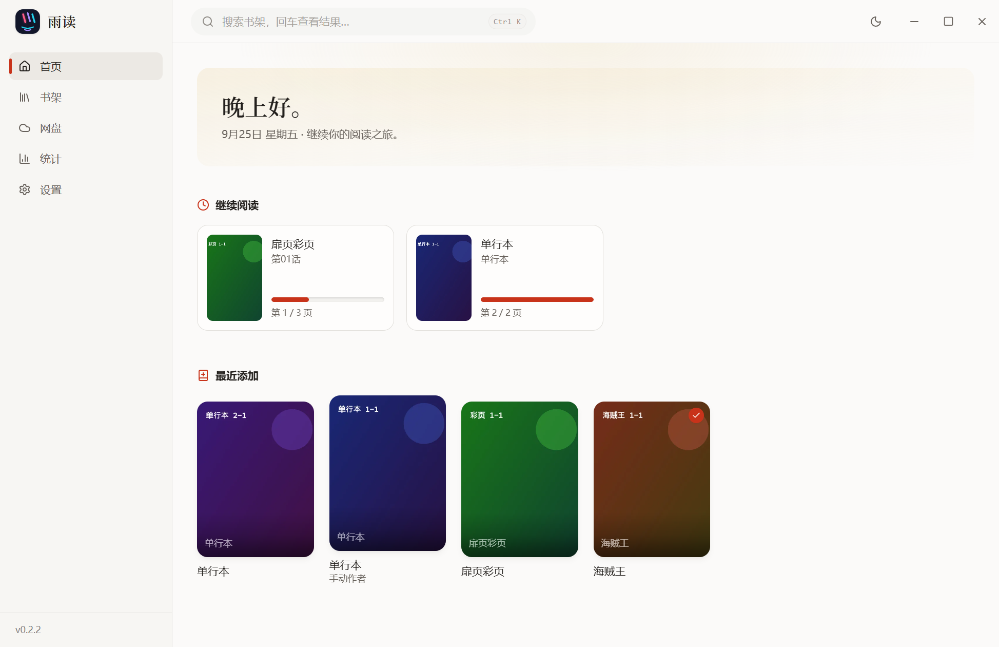
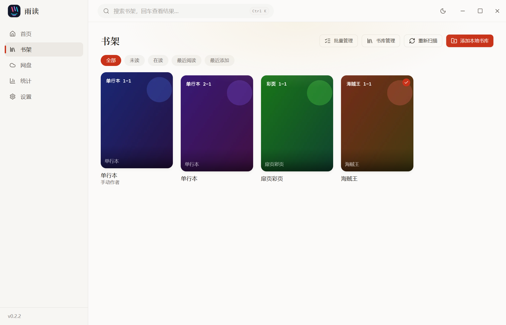
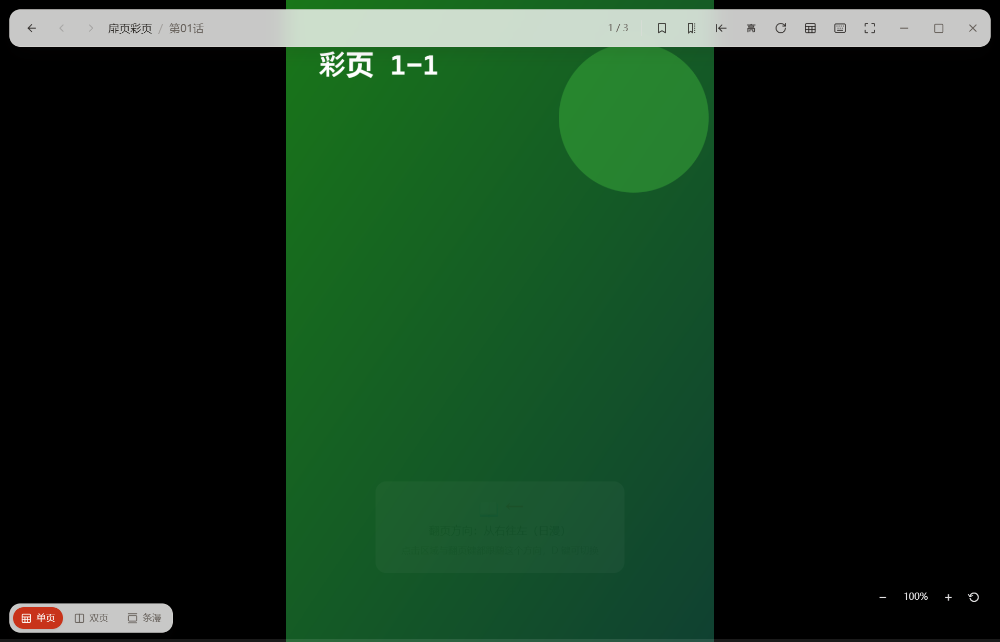
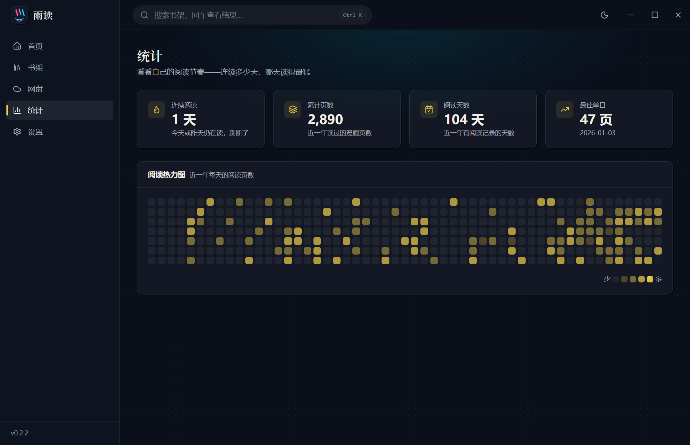
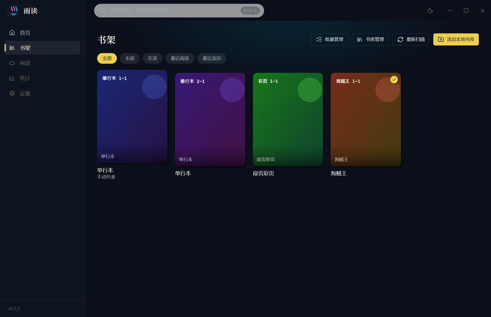

# 雨读 Yudu

精美的本地 + 天翼云盘 / 115 网盘 / WebDAV 漫画阅读器（Electron + React）。

把漫画文件夹或云盘目录加进书架即可阅读：本地支持散图文件夹与 CBZ/ZIP、CBR/RAR、CB7/7Z、CBT/TAR、EPUB、PDF，图片含 JPG/PNG/WebP/AVIF/GIF/BMP/APNG/SVG；伪装扩展名（如 zip 存成 .cbr）按文件头魔数自动纠正；
云端目录自动识别「单系列」与「多系列」两种布局，读过的内容会缓存到本地，断网也能看。

## 界面预览

（截图取自开发自测书库，封面为生成的占位图）

| 首页 · 纸墨书斋（浅色） | 书架 · 封面墙与阅读状态 |
| --- | --- |
|  |  |

| 阅读器 · 方向提示与悬浮工具栏 | 统计 · 阅读热力图（现代漫画 · 深色） |
| --- | --- |
|  |  |

深色主题下的书架：



## 功能

- **外观**：纸墨书斋、现代漫画、霓虹夜读三套主题，设置页用书架预览卡选择，顶栏也可直接切换；自动记住选择，设置分区支持快捷跳转。

- **书架**：封面墙（虚拟滚动）、按标题全文搜索、未读 / 在读 / 已读完 / 最近阅读 / 最近添加筛选、批量移出书架；返回详情前的筛选与滚动位置，封面进度包含当前话已读页码
- **系列页**：ComicInfo.xml 元数据（含压缩包内 ComicInfo 与 EPUB 的 OPF 书名/作者、年份/语言）、章节按卷号分组、手动编辑信息（重扫不覆盖）、逐话进度、单话勾选已读、整系列标记已读 / 重置进度、单系列重扫；扫描失败的章节在列表中标红并显示原因（每轮扫描自动重试）
- **扫描引擎**：系列级并行扫描（4 路）、增量对账（size/mtime）、移动/改名的系列按章节指纹自动找回并转移阅读进度/书签
- **阅读器**：单页 / 双页 / 条漫三种模式；适宽 / 适高 / 原始；日漫从右往左；旋转；缩放；缩略图条；沉浸全屏
  - **跨话连读**：末页继续翻页自动进入下一话（首页回上一话末页），顶栏与末页提示卡可手动跳转；前后话首/末页预取让跨话首屏零等待
  - **方向提示**：进入阅读器时浮层提示当前翻页方向（条漫除外）
  - **跳页输入**：点击顶栏页码输入页码回车直达
  - **书签**：`B` 收藏当前页，面板内跨话跳转（缩略图条上也会标记）
  - **跨页大图识别**：双页模式下扉页/彩页等横宽页自动单独占满一屏（页尺寸按需探测并缓存）
  - **跨页配对手动修正**：`C` 键切换两两配对的起始偏移（第 1 页单独 ↔ 从第 1 页配对），按系列记忆，修正自动配对落空
  - **图片加载失败自动重试**（云端瞬时报错不再留裂图，仍失败可手动重试）
- **阅读偏好**：按系列记忆 + 全局默认值（设置页可配新书默认模式/适配/方向）
- **阅读画面**：`G` 打开虚拟滚动的页面全览，点击跳页；`E` 开关图像增强（锐化、对比度、裁白边），处理显示副本，原文件不变。单边超过 4000 像素或多帧图片保留原图。护眼面板提供亮度、暖色滤镜及 20:00–次日 07:00 的暖色时段。
- **PDF 阅读**：阅读器代码按需加载；大文件通过 `yudu://file` 的 HTTP Range 分段读取，切话取消旧请求，远离视口的 canvas 回收。
- **阅读统计**：页数热力图及活跃阅读时长；失焦、后台或一分钟无操作时暂停，切话与离开时保存。
- **天翼云盘**：个人云 / 家庭云，凭据经系统级加密保存在本机；云端缓存带容量上限与 LRU 清理，可按系列查看和清理占用。清理前以主题确认框展示范围、大小和离线影响，取消保留缓存与阅读进度。
- **115 网盘**：扫码登录（cookie 经系统级加密保存在本机），目录挂载 / 扫描 / 阅读 / 离线缓存与天翼云盘同一套体验
  - **Range 直读**：云端 zip/CBZ 经下载直链按段读取中央目录与页面，不必先下载整包；不支持时自动回退整包下载。
  - **离线缓存**：整系列预取（章节进度、取消、失败重试）；完成后逐文件核验，展示完整话数与缺失章节。预取会保护该系列免于 LRU 淘汰，保护内容合计受容量限制，可解除保护。手动清理先取消并等待下载收尾。
  - 并发下载限流（同时最多 5 个）与同页请求去重。
- **WebDAV / NAS**：网盘页填写目录地址、用户名与密码 / 应用密码；验证后自动扫描，支持散图、压缩包、PDF、Range 直读和离线缓存。使用 HTTP/HTTPS + Basic 认证及标准 PROPFIND；不支持 OAuth 登录或跨站重定向。
- **在线元数据**：系列页「元数据」手动搜索 [AniList](https://docs.anilist.co/guide/graphql/queries/media)，标题只在点击搜索后发送；预览并确认候选，才替换本地信息，重扫不会覆盖。
- **ComicInfo 回写**：系列页将已保存的信息写回本地目录或 ZIP。ZIP 在副本中更新，逐页验证字节不变，并另存原包；其他单文件格式写相邻 `.ComicInfo.xml`，不重打包 RAR/7Z/EPUB/PDF。
- **系列详情**：首屏作品卡突出封面、书名、作者、进度与阅读入口；章节支持按话名、话号和卷号搜索，按卷折叠，定位当前续读话时自动清除搜索并展开目标卷。作品信息、书架标签和系列管理分区展示，宽窗口并排，窄窗口纵向排列。
- **系列合并**：同书库系列合并展示，按卷话排序，保留原文件、章节 ID、进度、书签和扫描归属；支持解除。重复章节保留，不自动删除。操作前备份数据库。
- **系统集成**：本地库文件变动自动重扫（可在设置关闭）、窗口位置/尺寸记忆、启动时恢复上次阅读（可关）
- **数据备份**：进度与书签 JSON 导出 / 事务导入，保留原时间戳；合并后仍按原目录对账。设置页另有完整 SQLite 快照，包含书架、标签、偏好、元数据和连接配置；启动时距上次满 24 小时自动备份，可手动创建、设置保留数量。恢复确认框展示选中备份时间、大小和类型，确认后校验并另存安全快照，重启后替换。数据库备份不复制漫画文件，加密凭据与原系统用户绑定。

## 环境要求

Node.js ≥ 22、pnpm（当前 `better-sqlite3` 要求 Node.js ≥ 22）。`sharp`、`better-sqlite3` 含原生模块，需确保当前平台的依赖完整安装。

```bash
pnpm install
pnpm dev        # 开发（electron-vite dev）
pnpm typecheck  # 主进程 + 渲染进程类型检查
pnpm test       # 单元测试（vitest）
pnpm build      # 构建到 out/
pnpm test:reader # 构建后运行，使用临时目录验证真实 Electron 阅读器与文件关联
pnpm dist       # 打包（electron-builder，Windows：nsis）
```

## 快捷键（阅读器）

| 按键 | 作用 |
| --- | --- |
| `→` / `↓` / `空格` / `PageDown` | 下一页（条漫为向下滚动一页；末页自动进下一话） |
| `←` / `↑` / `退格` / `PageUp` | 上一页（首页自动回上一话末页） |
| `Home` / `End` | 第一页 / 最后一页 |
| `C` | 跨页配对（双页模式）：切换两两配对的起始偏移 |
| `D` | 切换阅读方向：日漫（从右往左）/ 西漫（从左往右） |
| `M` | 循环切换 单页 → 双页 → 条漫 |
| `S` | 循环切换 适宽 → 适高 → 原始 |
| `R` | 旋转 90° |
| `T` | 缩略图条 |
| `G` | 页面全览网格（图片章节） |
| `E` | 图像增强开关（图片章节） |
| `B` | 收藏 / 取消当前页书签 |
| `F` | 全屏 |
| `回车` | 沉浸模式（隐藏界面，鼠标移动自动恢复） |
| `?` | 快捷键帮助（键盘图） |
| `Esc` | 关闭面板 → 返回（全屏时先退出全屏） |

鼠标：左右各 1/3 区域点击翻页（日漫方向时左右互换）；`Ctrl/⌘ + 滚轮` 缩放。

## 目录结构

```
src/
  main/                 主进程
    archives/           压缩包驱动（folder / zip / epub / rar / 7z / tar，魔数嗅探兜底），带 LRU 缓存
    cloud189/           天翼云盘：登录、列目录、下载缓存、扫描
    cloud115/           115 网盘：扫码登录、列目录、阅读取页（解析逻辑独立可单测）
    cloud/              云盘共用管线：扫描器（provider 描述符注入）
    scanner/            本地库扫描、文件名解析、ComicInfo.xml
    db/                 SQLite（schema 迁移、FTS5 搜索、进度）
    protocol.ts         yudu:// 自定义协议
    ipc.ts              IPC 入口（含扫描任务编排）
    pageThumb.ts        页缩略图生成与容量回收
    thumbnail.ts        系列封面生成
  preload/              contextBridge API
  renderer/src/         React 界面（路由 / 组件 / zustand store）
  shared/               主进程与渲染进程共享的类型
```

### 关键设计

- **图片走自定义协议而不是 IPC**：`yudu://page/{chapterId}/{index}` 由 `` 直接加载，享受 Chromium 的解码缓存，翻页零拷贝。
  另有 `yudu://page-thumb/...`（缩略图条用，主进程 sharp 缩小后落盘）、`yudu://thumb/{seriesId}`（封面）、`yudu://file/{chapterId}`（整包字节，PDF 用）。
  同一页的并发请求在协议层去重，云盘下载全局限流 5 并发；文件协议支持 HEAD、单段 Range 和取消，仅向应用自身来源开放 Fetch。
- **页码始终按阅读顺序递增**，日漫的左右排布只由 `spreadPages` 处理 —— 不要在 `next`/`prev` 里再按 `rtl` 反向，否则双页模式会卡在首页。
  `page` 语义是「当前 spread 的起始页」：封面 `[0]` → `(1,2)` → `(3,4)`…；跨页大图（`page_dims` 表中 w>h 的页）单独占一屏，翻页步长随之变化。
  `spreadOffset`（`C` 键）切换配对偏移：`1` = 第 1 页也单独，配对从第 2 页开始（`(2,3)(4,5)…`），用于修正「正文首页是独立扉页」的自动配对落空；按系列记忆。
- **页数可能未知**：云端压缩包要下载整包后才知道页数，PDF 的页数由渲染进程 pdfjs 统计。
  `pageCount` 为 0 表示未知，此时不做页码上界钳位、不判定「已读完」；页数回填后主进程会广播 `chapter:pageCount` 通知界面刷新。
- **云端 zip 的 Range 直读**（`archives/remoteZip.ts`）：解析中央目录只需 2~3 个字节段请求，单页按中央目录定位本地头再取压缩字节（store 直接返回、deflate 用 zlib inflateRaw），支持基本 zip64；直链 403 时换新链接重试一次。
  仅本地未缓存时启用；探测到服务器不支持 206 或解析失败自动回退整包下载，已缓存文件永远优先走本地。
- **扫描是增量的**：按 size + mtime 跳过未变化章节的页数统计；`series_fts` 每次扫描重建（藏书量级下成本可忽略）。
  手动编辑过元数据的系列（`meta_edited=1`）重扫时不覆盖 title/author/status/tags/description。
- **消失的系列不硬删**：源目录不可用（移动硬盘未挂载、根目录改名）时，有阅读进度的系列只标记 `missing` 并保留进度，重新扫描到即恢复。
- **合并不改变扫描归属**：`series_merges` 记录来源与主系列，阅读查询使用有索引支持的 `effective_chapters` 视图；扫描仍按原目录对账，移动重定位同步迁移关联、阅读日志、偏好、书架与标签。
- **数据库快照包含 WAL**：调用 SQLite backup API；恢复文件先校验，在下一次启动打开连接前替换，不复制运行中的单个 `yudu.db` 作为备份。

## 数据存放位置

Windows 下为 `%APPDATA%\雨读 Yudu\`：

- `yudu.db` — SQLite（书库、系列、章节、进度、设置）
- `thumbs/series-<id>.webp` — 系列封面
- `thumbs/pages/<chapterId>/` — 页缩略图（上限 256MB，超出按最久未用回收）
- `cache/cloud189/`、`cache/cloud115/`、`cache/webdav/` — 云端缓存（共用一套 LRU 索引 `index.json`，容量上限见设置页）
- `backups/` — 完整数据库快照；普通与恢复前安全备份分别按保留数量清理。

删除书库会清掉其缓存产物；「移出书架」只是隐藏，不删进度。

## 开发调试钩子

主进程支持一组环境变量，便于无头验证与截图：

| 变量 | 作用 |
| --- | --- |
| `YUDU_SCREENSHOT=<png路径>` | 启动后截图并退出 |
| `YUDU_ROUTE=<hash路由>` | 截图前跳转，如 `library` 或 `reader/12` |
| `YUDU_THEME=light` | 截图前切浅色主题 |
| `YUDU_KEY` / `YUDU_KEY_TIMES` | 截图前模拟按键 |
| `YUDU_EVAL=<表达式>` | 在渲染进程求值并打印 |
| `YUDU_A11Y=1` | 暴露无障碍树（供桌面自动化 / 读屏器） |
| `YUDU_SELFTEST=<fixture目录>` | 跑一遍加库→扫描→读页→封面→进度→书签/跨话/已读/页尺寸自检 |

`scripts/` 下另有若干一次性排查脚本（天翼云盘审计、Range 支持探测、fixture 生成、图标/PDF 生成、截图数据种子）：
`node scripts/make-fixture.js`（需 `FIX_ROOT` 环境变量）可生成自测用的本地书库。

`pnpm build` 后运行 `pnpm test:reader`：自动创建临时 fixture 和 `--user-data-dir`，验证 PDF Range / 键盘跳页 / 切话 / 画布回收、条漫跨话与模式切换、全览跳页、跨页大图、护眼偏好、主题 / 设置键盘交互、弹窗焦点、连续书架 / 标签保存、重置确认、缓存实际清理与进度保留、备份恢复取消、三主题系列详情及宽 / 窄窗口布局、WebDAV 入口、文件关联冷启动与热启动，以及连续重开后的窗口尺寸保持。输出 `SELFTEST_OK`、`READER_DOM_OK`、`UI_DOM_OK`、`INTERACTION_DOM_OK`、`CONFIRMATION_DOM_OK`、`SERIES_LAYOUT_OK`、`THEME_LAYOUT_OK`、`FILE_ASSOCIATION_DOM_OK`、`WINDOW_RESTORE_OK`，并打印截图所在目录。只终止脚本创建的进程，不触碰真实用户数据。

书架交互回归还会生成 120 话的隔离系列，验证返回定位、筛选记忆、章节搜索 / 折叠 / 定位，并通过临时 Electron 入口注入一次首页请求故障，验证两个分区独立重试。对应输出为 `LIBRARY_DOM_OK` 与 `HOME_ERROR_DOM_OK`。

## 天翼云盘的两个坑（已在代码中处理）

- 官方「家庭云」界面展示的内容实际在 `我的应用/家庭云` 子目录下，open API 的 `-11` 根目录只返回系统默认空文件夹，因此列目录时会自动下钻对齐官方视图（见 `cloud189/client.ts`）。
- 下载直链带 XML 实体转义（`&amp;`），不解码就去请求会因参数失效返回 403，必须解码后再 fetch。

## 115 网盘接入备注

- 登录走 web 扫码链路（`qrcodeapi.115.com` 取 token 与官方渲染的二维码图片 → 轮询 `get/status` → `passportapi` 以 tv 设备身份换 cookie），tv 设备可避免顶掉手机/网页端已登录的会话；cookie（UID/CID/SEID）经 safeStorage 加密落盘。状态轮询在 GET 被网络中间层静默断开时自动降级 POST 表单重试。
- `webapi.115.com/files` 已改为只收 POST 表单（GET 一律 405）；下载直链按 p115client 的做法以空 UA 请求，换取与 UA 无关的 CDN 链接。
- 115 的 web 接口对频率敏感且对海外/异常网络环境有封锁：所有 API 调用经 400ms 最小间隔的串行队列，返回 HTML 拦截页时给出可读错误；会话失效（errNo 990001）与限流经全局 Toast 提示。
